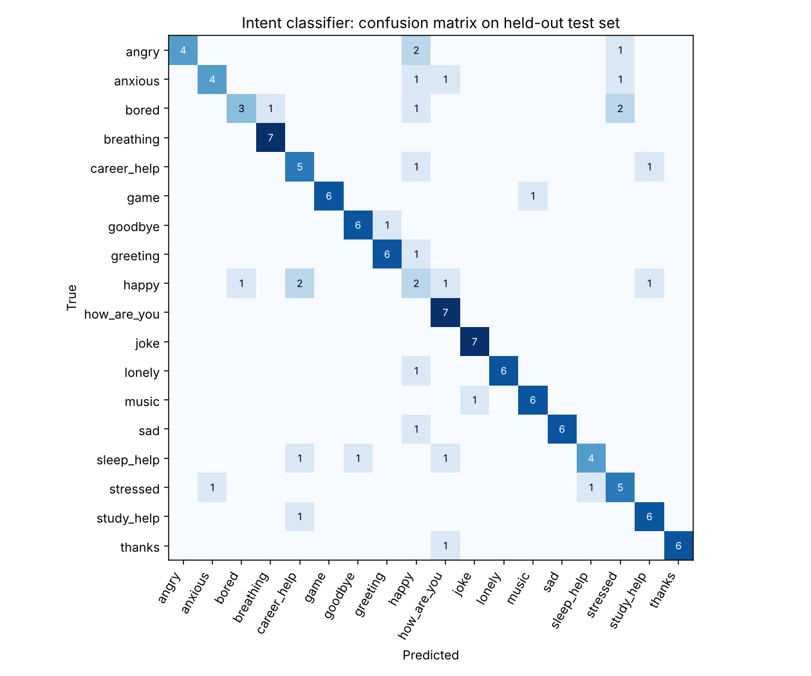

# Nova: A Friendly Companion Chatbot

Nova is a friendly chatbot that runs entirely in your browser. It chats like a friend, checks how you feel, plays games, gives advice, suggests music and can talk out loud. No install, no server, no API key. Just open `index.html`.

**Live demo:** https://YOUR-USERNAME.github.io/school-chatbot/

## Features

- **Friendly chat:** mood check-in, "let me vent" listening, daily check-in and a private journal
- **Voice:** spoken replies, mic input and a hands-free talk mode
- **Games:** trivia, riddles, guess the number, would-you-rather, rock paper scissors
- **Help:** advice on study, exams, career, sleep and more, music by mood and language, breathing exercise, timers, to-do list
- **Safety:** if someone mentions self-harm, Nova responds with care and shares helpline info (Tele-MANAS 14416)

## Understanding messages: rules + a trained model

Nova first uses keyword rules. When they don't match, a **TF-IDF + logistic regression** intent classifier, trained in Python and run in the browser, tries to understand the message. If it is only moderately sure, Nova asks "did you mean...?" instead of guessing. In Settings, "Show how Nova understood me" displays the predicted intent and confidence.

On a held-out test set of rephrased messages, the keyword rules scored **31% accuracy** and the trained model **76%**. Details, limitations and reproduction steps are in [`nlp/README.md`](nlp/README.md).

## Tech stack

HTML, CSS and vanilla JavaScript, with the Web Speech API for voice. Python (scikit-learn) for training. Hosted on GitHub Pages. Voice works best in Chrome or Edge.

## Run it locally

Download or clone the repo and open `index.html` in a browser. To retrain the model: `cd nlp && pip install -r requirements.txt && python train.py`.

## Future improvements

- A larger dataset collected from real users, and Tamil/Hindi support
- Connect to a language model through a small backend for open-ended chat
- Spelling-mistake tolerance

## Note

Nova is a friendly bot, not a doctor or therapist. For serious problems, please talk to a trusted person or a professional.

## License

MIT. See [LICENSE](LICENSE).
